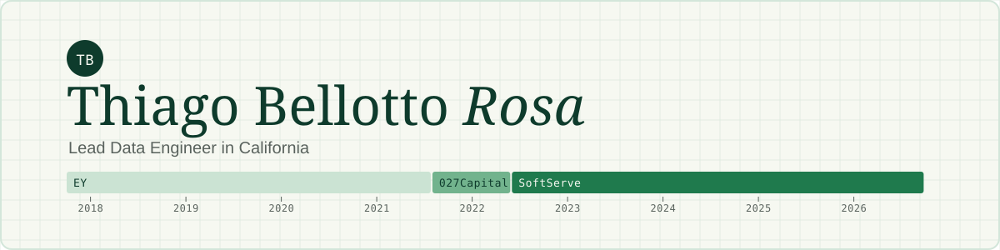

 
I design and lead cloud data platforms, mostly for US healthcare: lakehouses, streaming and batch pipelines, clinical-data ingestion (FHIR, C-CDA, OMOP) and the infrastructure that runs them. Before data engineering I spent four years in audit and M&A due diligence at EY.
 
> **Currently:** building [Saudade Island](https://saudadeisland.com), a small world in Three.js.
 
[Website](https://thiagobellotto.com?ref=github) · [LinkedIn](https://www.linkedin.com/in/thiago-bellotto/) · [Medium](https://thiago-bellotto.medium.com/)
 
---
 
### What I work with
 
| | |
|---|---|
| **Cloud** | AWS · Azure · Google Cloud |
| **Lakehouse & warehouse** | Databricks · Snowflake · Redshift · Delta Lake · Iceberg · Hudi |
| **Databases & search** | PostgreSQL / Aurora · DynamoDB · OpenSearch · SQL Server |
| **Pipelines & streaming** | Python · SQL · dbt · Airflow · Kafka · Glue · DMS · Step Functions · Lambda |
| **Services & apps** | FastAPI · Docker · Kubernetes · ECS · Cloud Run |
| **Infrastructure & delivery** | Terraform · Pulumi · GitHub Actions · CodePipeline · Cloud Build |
| **ML & analytics** | AWS Personalize · Textract · Comprehend Medical · scikit-learn · Metabase · Power BI |
 
### Selected projects
 
- **[Washington EV Explorer](https://github.com/thiagobellotto/washington_ev_explorer)**: analytics on Washington State's electric-vehicle registrations.
- **[Airflow + Postgres pipeline](https://github.com/thiagobellotto/airflow-postgres-pipeline)**: a containerized ETL that ingests a public API into PostgreSQL.
- **[QR code generator](https://github.com/thiagobellotto/qrcode_generator)**: a small Streamlit app ([try it](https://qrcode-generator.streamlit.app/)).
---
 
More about my work at [thiagobellotto.com](https://thiagobellotto.com?ref=github).
 
