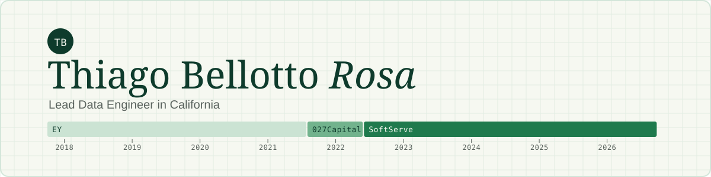

 
I design and lead cloud data platforms, mostly for US healthcare: lakehouses, streaming and batch pipelines, clinical-data ingestion (FHIR, C-CDA, OMOP) and the infrastructure that runs them. Before data engineering I spent four years in audit and M&A due diligence at EY.
 
> **Currently:** building [Saudade Island](https://saudadeisland.com), a small world in Three.js.
 
[Website](https://thiagobellotto.com/?ref=github) · [LinkedIn](https://www.linkedin.com/in/thiago-bellotto/)
